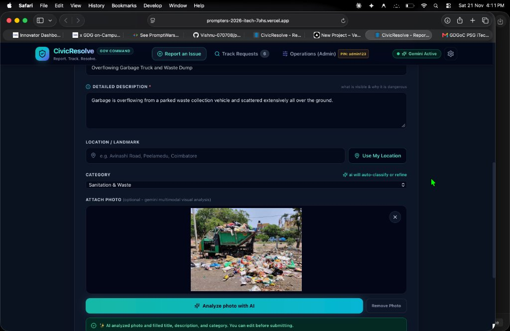
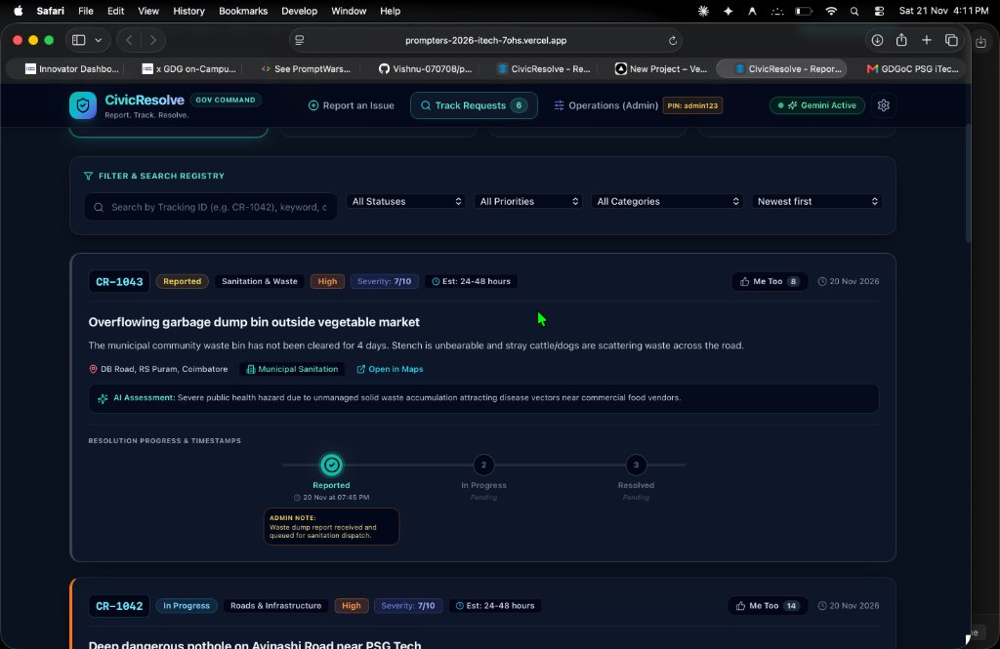
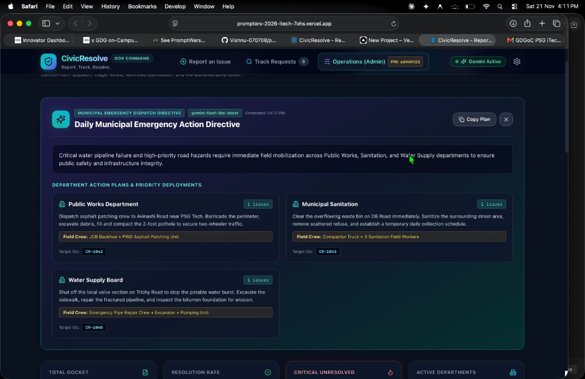
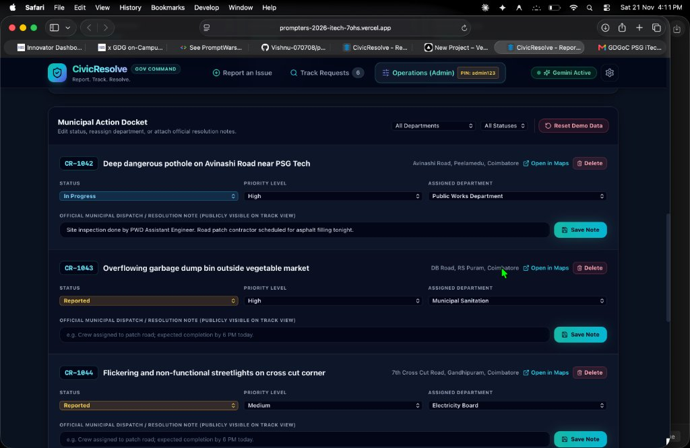

# CivicResolve — "Report. Track. Resolve."

AI-Powered Civic Issue Reporting & Municipal Triage Platform built for the **PromptWars 2026** Hackathon at PSG iTech (in collaboration with GDG on Campus PSG iTech).

**Live Demo:** https://prompters-2026-itech-7ohs.vercel.app


---

## 🌟 1. Problem Statement
In urban municipalities and smart cities, citizen grievance redressal is severely hindered by:
- **Chaotic, unstructured reporting**: Citizens submit vague descriptions or lack exact municipal categorization.
- **Manual triage bottlenecks**: Human desk officers must read thousands of daily complaints, manually identify the responsible department, and rank urgency.
- **Critical delay in hazardous scenarios**: Life-threatening civic emergencies (e.g., fractured high-pressure water mains, live snapped power lines, open storm drain trenches near primary schools) sit in the same queue as routine non-urgent cosmetic tasks.
- **Opaque resolution tracking**: Citizens lack visibility into which department is assigned, whether engineers inspected the site, or what real-world actions were taken.

---

## 💡 2. The CivicResolve Solution
**CivicResolve** transforms civic grievance reporting into an instantaneous, AI-directed municipal workflow:
1. **Citizen Submissions with Multimodal Analysis**: Citizens report issues using natural language, geolocation, and photos.
2. **Instant Gemini AI Triage**: Google Gemini classifies the issue into one of 6 official municipal categories, assigns an objective priority level (*Low*, *Medium*, *High*, *Critical*), routes it to the specific municipal agency, and synthesizes a 1–2 sentence civic impact reasoning.
3. **Public Service Requests Tracking**: An in-browser public dashboard (**"Track Requests"**, titled **"Service Requests"**) with search, status filters, and visual 3-step resolution progress trackers (`Reported` ➔ `In Progress` ➔ `Resolved`).
4. **Municipal Official Command Center**: Secured administrative console (**"Operations (Admin)"**) for ward officers to inspect AI triages, update operational statuses, reassign departments, and publish official site notes.

---

## 📸 Live Application Screenshots

| 1. Report an Issue — Snap-to-Fill with Gemini Vision | 2. Track Requests ("Service Requests") Public Docket |
| :---: | :---: |
|  |  |
| *Citizens attach photos; Gemini Vision auto-fills title, description, and municipal category in resident voice.* | *Interactive ticket card with live timestamps, "Me Too" community upvotes, severity score (1-10), ETA, and Google Maps.* |

| 3. Operations (Admin) — AI Daily Dispatch Directive | 4. Operations (Admin) — Municipal Action Docket |
| :---: | :---: |
|  |  |
| *AI synthesizes urgent high/critical incidents into prioritized operational directives grouped by department.* | *Municipal commanders inspect complaints, update status history, reassign crews, and publish official notes.* |

---

## 🚀 3. Key Features

- **Multimodal AI Citizen Grievance Portal & Snap-to-Fill**:
  - **Real Geolocation & OpenStreetMap Reverse-Geocoding with IP Fallback**: "Use My Location" requests precise browser geolocation coordinates (`lat`, `lng`), reverse-geocodes with OpenStreetMap Nominatim, and automatically populates the readable address. If browser geolocation fails (e.g. position unavailable on desktop), it seamlessly falls back to IP-based approximate lookup via `https://ipwho.is/`, filling `"City, Region (approximate)"`, saving coordinates, and showing a refinement note. If both fail, it leaves the field empty with a clear message and never uses fake/default locations.
  - **Google Maps Integration**: Saves coordinates with every complaint and provides **"Open in Maps"** links (`https://www.google.com/maps?q=lat,lng`) directly on public Track Requests ("Service Requests") and Operations (Admin) complaint cards.
  - **Snap-to-Fill with Gemini Vision**: Citizens upload an image and click **"Analyze photo with AI"** to automatically populate title, description, and municipal category before submission. Citizens can edit before submitting.
  - Image upload with instant preview and base64 transmission to Gemini vision-language capabilities.
  - Strict JSON schema enforcement via `@google/genai` returning category, priority, **Severity Score (1-10)**, and **Estimated Resolution Time** (e.g. "24-48 hours", "2-6 hours").
  - Generated Tracking ID (e.g., `CR-1042`) with 1-click clipboard copy.

- **Resilient AI Execution & Multi-Model Graceful Fallback**:
  - Connects to Google Gemini API via official `@google/genai` SDK using `VITE_GEMINI_API_KEY` and `VITE_GEMINI_MODEL` (`gemini-flash-lite-latest`).
  - **Zero-Crash Heuristic Mock Engine**: If no API key is configured, text triage runs in Mock AI mode with keyword-based classification, severity scores, and resolution times. When an API key is configured, Gemini Vision actively verifies uploaded photos; a failed or non-civic photo analysis returns a clear rejection and no longer falls back to a mock issue.
  - 15s timeout with automatic retry on 503 / timeout.
  - UI visual badges distinguish `Gemini Active` vs. `Mock AI mode`.

- **Public Service Requests Tracking, Citizen "Me Too" Upvotes & Filters**:
  - In-browser KPI counters (`Total Filed`, `Reported`, `In Progress`, `Resolved`).
  - **Citizen "Me Too" Upvotes**: Citizens can upvote existing complaints (strictly 1 vote per browser, persisted in `localStorage`) to signal collective impact.
  - **Sorting Options**: Sort by "Newest first", **"Most upvoted"**, or "Highest priority".
  - Color-coded priority badges, severity score badges (`8/10`), and estimated resolution times.
  - **Auditable Progress Stepper**: Interactive 3-step progress steppers (`Reported` ➔ `In Progress` ➔ `Resolved`) displaying **timestamps for every status change** alongside official municipal dispatch notes.
  - Pre-seeded with 6 realistic Coimbatore civic complaints (Peelamedu, RS Puram, Gandhipuram, Singanallur, Saravanampatti).

- **Municipal Operations Center & AI Daily Dispatch**:
  - **AI Daily Dispatch Summary**: Municipal commanders can trigger 1-click AI dispatch directive that aggregates all open High/Critical complaints and synthesizes an actionable operational directive grouped by department with recommended crew and equipment.
  - Secured Judge PIN gate (`admin123`) with 1-click bypass.
  - Departmental workload allocation metrics.
  - Real-time status toggling and official municipal dispatch note publishing that immediately updates the citizen Service Requests view with timestamps.

- **Runtime In-Browser AI Configuration**:
  - Settings modal (gear icon) allowing judges or evaluators to enter their own Google Gemini API key and select models (`gemini-flash-lite-latest`, `gemini-3.8-flash`, etc.) directly in `localStorage` without altering environment files.

---

## 🛠️ 4. Tech Stack

- **Frontend Core**: React 18, Vite 6, JavaScript (ES Modules)
- **Styling & Design System**: Tailwind CSS, Lucide React Icon Suite
- **Design System**: Dark civic control-room theme (slate-950/teal-cyan palette, glowing priority indicators, high WCAG contrast, visible focus rings, and full reduced-motion accessibility support)
- **Generative AI & LLM**: Google Gemini (`gemini-flash-lite-latest`) via the official `@google/genai` SDK
- **Data Persistence**: Browser `localStorage` (100% serverless, zero external database setup needed)
- **Deployment & Architecture**: Pure client-side SPA, lightweight repository footprint (< 5 MB)

---

## 🤖 5. Role of Google Gemini & Google Antigravity

- **Google Gemini**:
  - Acts as the cognitive triage engine. It analyzes natural language citizen descriptions alongside photo evidence, detecting spatial hazards, estimating municipal liability, and producing structured JSON metadata for department routing.
- **Google Antigravity**:
  - Used as the agentic coding environment to scaffold, implement, debug, and package the complete civic web app in a rapid agentic coding session.
  - Managed single-branch Git discipline, automated package integration, and ensured strict conformance to hackathon submission requirements.
  - A separate AI coding assistant (Codex) was used for a code audit and for hardening fixes (tracking-ID uniqueness, photo compression, prompt-injection protection).

---

## 💻 6. Setup & Installation Instructions

Follow these 3 simple steps to run CivicResolve locally:

### Prerequisites
- Node.js (v18.0.0 or higher recommended)
- npm (v9.0.0 or higher)

### 1. Clone & Install Dependencies
```bash
git clone https://github.com/Vishnu-070708/prompters_2026_itech.git
cd prompters_2026_itech
npm install
```

### 2. Configure Environment (Optional)
CivicResolve comes with a zero-setup Mock AI mode out of the box. To enable live Gemini AI:
```bash
cp .env.example .env
```
Edit `.env` and add your Gemini API Key:
```env
VITE_GEMINI_API_KEY=your_gemini_api_key_here
VITE_GEMINI_MODEL=gemini-flash-lite-latest
```
*(Alternatively, you can just start the app and paste your API key into the Settings modal via the gear icon in the top navigation bar!)*

> [!NOTE] **API Key Security Note for Hackathon Evaluators / Judges**
> Environment variables prefixed with `VITE_` are bundled directly into client-side browser code at build and runtime. This design is standard and intentional for a client-side hackathon prototype and zero-backend demo (allowing judges to easily evaluate the app or test their own key via the in-browser Settings modal). In a production environment, API requests would be routed through an authenticated backend proxy or serverless function to keep API keys secure and off the client.

### 3. Start Development Server
```bash
npm run dev
```
Open your browser at `http://localhost:5173`.

### 4. Run Automated Tests & Code Quality Suite
Run the full verification suite covering geolocation, prompt injection protection, upload validation, anti-hallucination rejection, and security headers:
```bash
npm test
npm run lint
npm run build
```

---

## 🎯 7. Quick Demo & Evaluation Guide for Judges

1. **Explore Existing Seed Complaints & "Me Too" Upvoting**:
   - Go to the **Track Requests** tab (titled **Service Requests**).
   - Review pre-loaded Coimbatore civic issues (e.g. `CR-1042` pothole on Avinashi Road, `CR-1045` water pipeline burst on Trichy Road).
   - Observe **Severity Score** (e.g. `8/10`), **Est. Resolution** (e.g. `24-48 hours`), and **timestamps on each progress step** along with official admin notes.
   - Click the **"Me Too"** button on any card to register your citizen upvote; observe the vote count increase and button state switch to "Supported" (persisted in `localStorage`).
   - Switch the sort dropdown to **"Most upvoted"** to see complaints re-ordered by community impact.

2. **File a New Citizen Complaint with Snap-to-Fill**:
   - Navigate to the **Report an Issue** tab.
   - Click **Use My Location** (fills in your approximate location, or type it manually).
   - Test **Snap-to-Fill**: Upload any civic damage image and click **"Analyze photo with AI"**.
   - Watch Gemini Vision auto-populate the Title, Description, and Category! Edit any field to customize before submitting.
   - Click **Submit & AI Triage Issue**.
   - Observe the instant AI triage card with assigned department (*Electricity Board / Police*), priority, severity score, estimated resolution time, and impact reasoning.

3. **Admin Operations & AI Daily Dispatch Summary**:
   - Click on the **Operations (Admin)** tab.
   - Click the yellow **1-Click Instant Judge Login** button (or enter PIN `admin123`).
   - Click **"AI Daily Dispatch Summary"** in the top right to generate a prioritized operational action plan for all open High/Critical complaints grouped by department.
   - Review or copy the departmental dispatch directive.
   - Update any complaint's Status (e.g., from `Reported` to `In Progress`) or add an Official Note.
   - Switch back to **Track Requests** and observe the live timestamp and updated admin note on that specific stage in the 3-step progress stepper!

---

## 📄 License
Open source under the MIT License. Developed for PromptWars 2026.

---

## 🧩 Prompts Used

Google Antigravity was guided with short iterative prompts covering:

1. **Initial build:** Create a React/Vite CivicResolve prototype with citizen reporting, AI triage, public tracking, and an admin dashboard.
2. **Feature upgrade:** Add severity scoring, estimated resolution times, progress timestamps, community upvotes, and a daily dispatch summary.
3. **Location refinement:** Use browser geolocation, OpenStreetMap reverse geocoding, and a clearly labelled approximate IP fallback without inserting a default address.
4. **Reliability pass:** Add Gemini timeouts, retry/fallback behavior, Mock AI mode, and resilient handling when a key or network is unavailable.
5. **UI redesign:** Restyle the whole app as a dark, service-oriented civic portal (service tiles, ticket-style request cards, operations-center admin view) without changing app logic.

## ⚠️ Known Limitations

- Location requires device permission and a usable location source; IP fallback is approximate and should be refined by the citizen.
- Gemini free-tier limits, invalid keys, or network failures switch complaint triage to rule-based Mock AI mode. Photo verification reports an error directly without defaulting to a mock issue.
- This prototype stores the Gemini key in client-side configuration (`VITE_` variables are visible in the browser). A production deployment must use a backend proxy and authenticated server-side key storage.
